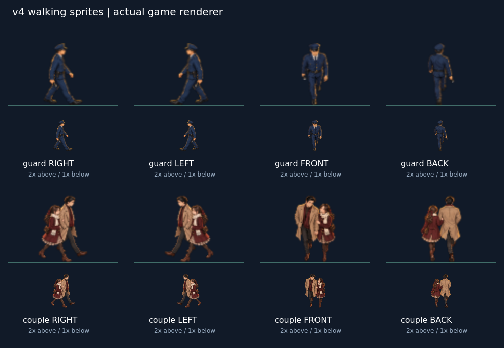

# v4 移動方向別スプライト — 制作・実装・検証

2026-10-10 / 基準main: `c8caa8039892f9cafe9d7d4f360f175ca1a9ee14`

## 納品

既存の警備員2点とカップル2点を参照してbuilt-in imagegenで6点を制作。紺色制服・制帽、ベージュの男性コート、えんじ色の女性コート、マフラー・スカート・バッグ・髪型、イラストの線と暖色の縁光を合わせた。横向きの初稿は正面寄りだったため修正し、背面のカップルは左右の並びとバッグ・マフラーを修正した。生成・修正指示の全文は [PROMPTS.md](../../game/assets/v4/PROMPTS.md)。

| 配置先（game/assets/v4/） | PNG寸法 | 向き | 描画範囲 x,y,w,h | ゲーム内高さ |
|---|---|---|---|---|
| npc_guard_walk_side.png | 512×512 | 右（左は反転） | 103,4,306,508 | 62px |
| npc_guard_walk_front.png | 512×512 | 手前 | 145,4,221,508 | 62px |
| npc_guard_walk_back.png | 512×512 | 奥 | 151,4,210,508 | 62px |
| npc_couple_walk_side.png | 640×512 | 右（左は反転） | 131,4,377,508 | 66px |
| npc_couple_walk_front.png | 640×512 | 手前 | 164,4,311,508 | 66px |
| npc_couple_walk_back.png | 640×512 | 奥 | 165,4,309,508 | 66px |

すべてRGBA・背景透過。ImageMagickでalpha > 12の外接矩形を切り出し、縦横比を保って高さ508pxへ縮小、指定キャンバスの下端・左右中央へ配置。画像の下端が接地面になる。余白を横へ伸ばして人物を歪ませる処理はしていない。

## 実装

- 既存の `ASSET_SRC` と `WALK` が指定していたファイル名で配置し、追加した `TRIM` で透明余白を描画サイズから除外。
- `CHAR_H` の既定値（警備員62px、カップル66px）を維持。足元は既存の `y + 4 - abs(sin(step)) * 2.2` に一致。2.2pxの上下動は既存の歩行表現。
- 正面・背面の `WALK` 反転係数を0へ変更。縦方向へ進みながらvxが少し負になっても2人の並びや手持ち品が反転しない。横向きと未読込時の代用処理は従来どおり。
- 通行カップルの既存ルートは左右移動のみ。手前・奥の画像は共通の歩行描画と、上下移動可能なデートカップルで使用・確認。通行ルートを増やすような仕様変更はしていない。
- イルミネーション4点、ステージ定義、得点・制限時間・判定・移動ルール・主人公素材は変更なし。

## 検証結果

| 検証 | 結果 |
|---|---|
| 6点のPNG寸法・RGBA・透明背景・alpha外接矩形・下端 | 合格 |
| 既存 `run_tests.py` | 94件 PASS / 0 FAIL |
| 実ブラウザの描画検証 | 48ケース PASS |
| 専用画像のリクエストを遮断した代用表示 | 8ケース PASS |
| JavaScript実行時エラー | なし |
| 向き・顔や足先の欠け・サイズ・接地の画像目視 | 確認済み |

追加48ケースは、2画面幅 × 2キャラクター × 6方向（右・左・手前・奥・左手前・左奥）× 2歩行位相。実際の `drawWalker()` が選んだ画像URL、左右反転、ソース矩形、62/66pxの高さ、足元座標、描画後のalphaピクセルを確認。幅1280×900と390×844、deviceScaleFactor=1のheadless Chromium 134で実施。

テストは一時HTTPサーバーが返すJavaScriptにだけ検証用フックを追加する。配布する `game.js` に描画検証専用APIは増やしていない。既存テストには使用するChromiumを環境変数で選べるオプションだけ追加。

```bash
python -m pip install Pillow playwright
python -m playwright install chromium
python game/tests/test_walk_sprites.py
python game/tests/run_tests.py
```

インストール済みブラウザを使う場合は `PLAYWRIGHT_CHROMIUM_EXECUTABLE` に実行ファイルのパスを指定。確認画像の出力先は `WALK_QA_OUTPUT` で指定（既定 `/tmp/xmas-walk-qa`）。今回、新しいChromiumの取得が失敗したため、環境に存在したChromium 134を指定して実行した。

## 確認画像・ログ



- [PC幅の確認シーン](stage-1280.png) / [スマホ幅の確認シーン](stage-390.png)
- [回帰テストログ](regression.log) / [歩行画像テストログ](walk.log) / [描画計測値](walk-checks.json)

画面画像は、実際のステージ背景と描画経路を使い、テスト内でキャラクターを方向別に並べた確認用シーン。人物を隠す工作対象と開始テロップは、この確認シーン内だけ非表示にしている。通常プレイ画面をそのまま撮影したものではない。

## 未実施・範囲

- 実機のiOS Safari・Android Chrome/WebViewと実機タッチ操作は未検証。スマホ幅のChromium確認は実機検証の代わりではない。
- 1方向1枚の静止歩行ポーズ。連番の足踏みアニメーションや新しい歩行ルートは制作対象外。
- mainへのマージ・公開サイトへの反映は、この作業では実施しない。
